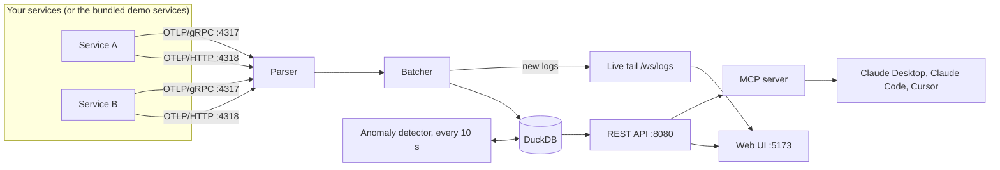

# TraceLens

**A self-hosted observability engine.** TraceLens ingests OpenTelemetry traces and logs, stores them in DuckDB, and gives you a trace flamegraph, a live log explorer, a service dependency map, automatic anomaly detection with root-cause correlation, and an MCP server so an AI assistant can investigate incidents for you.

Built for **CodeSangam / Webster 2026**, problem statement **08: The Eye of Agamotto (Distributed Telemetry & Observability Engine)**.

---

## Contents

- [What it does](#what-it-does)
- [Architecture](#architecture)
- [Getting started](#getting-started)
- [Try the demo: break something and watch TraceLens find it](#try-the-demo-break-something-and-watch-tracelens-find-it)
- [Send your own telemetry](#send-your-own-telemetry)
- [How anomaly detection and root cause work](#how-anomaly-detection-and-root-cause-work)
- [MCP server (ask an AI)](#mcp-server-ask-an-ai)
- [Configuration](#configuration)
- [REST API](#rest-api)
- [Project structure](#project-structure)
- [Testing](#testing)
- [Troubleshooting](#troubleshooting)
- [Known limitations and roadmap](#known-limitations-and-roadmap)
- [Team and license](#team-and-license)

---


## What it does

Mapped to the problem statement:

| Tier | Requirement | In TraceLens |
|---|---|---|
| Pass | OTel ingestion gateway (HTTP and gRPC) with batching | OTLP/HTTP (JSON and protobuf) on `:4318`, OTLP/gRPC on `:4317`, one shared parser, and a batching writer (flushes at 500 rows or every second, with a bounded queue) |
| Pass | Distributed trace flamegraph | Waterfall timeline per trace: parent/child spans, durations, HTTP status colours, a span panel with attributes and that span's logs |
| Pass | Live log explorer with full-text regex and dynamic tag filtering | Text and regular-expression search, tag filters on any attribute (`user.id`, `order.id`, `sku`, ...), a timeline histogram, a Fields panel, and **Live tail** over WebSocket |
| Pass | Service topology map | Auto-generated dependency graph from the spans, with latency, error rate and health on every node and edge |
| Victory | Columnar storage engine | **DuckDB** (embedded, columnar) for all analytical queries |
| Victory | Automated root-cause correlation | A detector compares each service with its own baseline, groups alarms into incidents, names the **root-cause service**, and lists the **operations whose p99 spiked** and the **alarms that belong to the same incident** |
| Victory | MCP server | Seven read-only tools, four resources and one prompt, over stdio or Streamable HTTP, with structured output |

### The pages

| Page | Route | What you can do |
|---|---|---|
| Dashboard | `/` | Requests, error rate, avg and p99 latency, time-series charts, per-service health table, the latest anomalies |
| Traces | `/traces` | Search by service, status, duration and text; open a trace as a flamegraph; click a span for its attributes and logs; jump from a log line to its trace |
| Logs Explorer | `/logs` | Full-text and `/regex/` search, tag filters, severity presets, histogram, **Live tail**, infinite scroll to older logs, jump to the trace |
| Topology | `/topology` | Layered service graph with draggable nodes, health colours, a side panel per service or connection, time range from 1 minute to 24 hours |
| Anomalies | `/anomalies` | Incidents with one root cause each, why that service was blamed (vote bars and sample traces), spans whose p99 spiked, related alarms, and links to the map, logs and traces |
| Demo Controls | drawer, bottom right | Make a demo service slow or flaky for a chosen time, then clear it |

---

## Architecture



**Data flow.** Telemetry arrives over HTTP or gRPC. Both paths go through the same parser, so they produce identical rows. The batcher writes spans and logs to DuckDB in batches and also publishes new log rows to the Live tail WebSocket. The detector queries DuckDB every 10 seconds and writes anomalies back. The UI and the MCP server read everything through the REST API.

**Design decisions**

- **DuckDB** lets the dashboards and the detector run heavy aggregations (p99, grouping, joins on spans) directly, with no separate database server to install.
- **The MCP server calls the REST API and never opens the database.** DuckDB allows one process on the file, and the backend already holds it. This also lets the MCP server restart or run on another machine without touching ingestion.
- **One parser for HTTP and gRPC** means the two protocols can never drift apart.
- **Health has one definition** (`backend/server/src/shared/health.js`): degraded at p99 ≥ 500 ms or errors ≥ 3%, failing at p99 ≥ 1 s or errors ≥ 10%. The Dashboard, Topology and the MCP tools all use it.

**Tech stack:** Node.js 20+ (CommonJS), Express, DuckDB (`@duckdb/node-api`), `@grpc/grpc-js`, OpenTelemetry SDK (demo services), React 18, Vite, React Router, React Flow (`@xyflow/react`), `@modelcontextprotocol/sdk`, `zod`.

---

## Getting started

### Prerequisites

- **Node.js 20 or newer** (developed and tested on Node 22)
- npm (comes with Node)
- Free ports: `8080` (API), `4317` (OTLP/gRPC), `4318` (OTLP/HTTP), `3000-3003` (demo services), `5173` (web UI)

### Install

```bash
git clone <your-repo-url> TraceLens
cd TraceLens
npm install        # installs every workspace at once
```

### Run (four terminals, all in the repo root)

```bash
npm run server     # 1. API :8080, OTLP/HTTP :4318, OTLP/gRPC :4317, detector
npm run services   # 2. demo microservices: gateway :3000, cart :3001, inventory :3002, payment :3003
npm run loadgen    # 3. virtual users shopping against the gateway
npm run web        # 4. web UI at http://localhost:5173
```

Open **http://localhost:5173**. The Dashboard fills within a few seconds.

> **Wait about 10 minutes before injecting a failure.** The detector compares each service with a 30-minute baseline that ends 5 minutes before the current window, and it needs at least 20 spans per service in both. On a brand-new database there is no baseline yet, so it stays quiet on purpose. Topology and the Dashboard react immediately because they do not use history.

Useful options for the load generator:

```bash
npm run loadgen -- --rps 5 --duration 600 --users 50 --checkout 0.4
```

| Flag | Default | Meaning |
|---|---|---|
| `--rps` | 5 | User flows per second |
| `--duration` | 0 | Seconds to run (0 = until Ctrl+C) |
| `--users` | 50 | Size of the fake user pool |
| `--checkout` | 0.4 | Fraction of flows that go on to checkout |

On a laptop, keep it awake during demos (macOS: `caffeinate -d npm run loadgen`). A sleeping laptop produces absurdly long durations.

### Ports

| Port | What |
|---|---|
| 5173 | Web UI (Vite dev server, proxies `/api` and `/ws` to 8080) |
| 8080 | REST API and Live tail WebSocket (`/ws/logs`) |
| 4318 | OTLP/HTTP ingestion (`POST /v1/traces`, `POST /v1/logs`) |
| 4317 | OTLP/gRPC ingestion |
| 3000-3003 | Demo services: gateway, cart, inventory, payment |
| 8081 | MCP server over HTTP (only when started with `npm run mcp:http`) |

### Where the data lives

DuckDB stores everything in `backend/server/data/observability.duckdb` (override with `DB_PATH`). The folder is git-ignored. Deleting it, or running `npm run seed -w backend/server -- --clear` with the server stopped, wipes all history including anomalies.

---

## Try the demo: break something and watch TraceLens find it

1. Start everything as above and let normal traffic run for about 10 minutes. Topology shows all four services healthy.
2. Open **Demo Controls** (bottom right) and choose **Payment slow (1.5 s)**. For a richer demo, add errors on payment as well.
3. Watch **Topology**: `payment` turns red within a minute, and the `gateway` that calls it follows.
4. Within 2-3 minutes the **Anomalies** page shows one incident:
   - **payment is the root cause**, with the gateway marked as a symptom
   - **Why payment?** shows the vote across sample traces and the span that spent the time on its own work
   - **Spans whose p99 spiked** shows `payment POST /charge` going from about 250 ms to over 2 s, plus the gateway spans that only waited on it, with failed counts
   - **Other alarms around the same time** lists the related alarms
5. Click **Slow payment traces**, open a trace, and see the flamegraph. In the span panel the fault shows up as `fault.injected=true`.
6. Open the **Logs Explorer**, type `service:payment level:WARN,ERROR` and switch on **Live tail**.
7. Click **Clear** in Demo Controls. Topology recovers, and the alarm stays in the history.

Faults live in the demo services' memory. They expire after the time you choose (or stay until you clear them), and restarting the demo services also removes them.

---

## Send your own telemetry

TraceLens is a standard OTLP backend. Point any OpenTelemetry exporter at it:

```bash
# any OpenTelemetry SDK or collector
export OTEL_EXPORTER_OTLP_ENDPOINT=http://localhost:4318            # HTTP
# or gRPC:  OTEL_EXPORTER_OTLP_ENDPOINT=http://localhost:4317  OTEL_EXPORTER_OTLP_PROTOCOL=grpc
export OTEL_SERVICE_NAME=orders
```

Or send one span by hand to see it arrive:

```bash
START=$(date +%s)000000000
END=$(( $(date +%s) * 1000000000 + 120000000 ))
curl -s -X POST http://localhost:4318/v1/traces -H 'content-type: application/json' -d '{
  "resourceSpans": [{
    "resource": { "attributes": [{ "key": "service.name", "value": { "stringValue": "orders" } }] },
    "scopeSpans": [{ "spans": [{
      "traceId": "5b8efff798038103d269b633813fc60c",
      "spanId": "eee19b7ec3c1b174",
      "name": "POST /orders", "kind": 2,
      "startTimeUnixNano": "'"$START"'", "endTimeUnixNano": "'"$END"'",
      "attributes": [{ "key": "http.response.status_code", "value": { "intValue": "200" } }],
      "status": { "code": 1 }
    }]}]
  }]
}'
```

A successful call returns `{}`. Malformed JSON or protobuf returns `400` with an error message.

The demo services can export over any of the three protocols, which is also how the ingestion paths are tested:

```bash
GATEWAY_PROTOCOL=json CART_PROTOCOL=proto INVENTORY_PROTOCOL=grpc PAYMENT_PROTOCOL=grpc npm run services
```

---

## How anomaly detection and root cause work

**1. Detection** (`backend/server/src/anomaly/detector.js`, every 10 seconds). For every service, the SERVER spans of the last 2 minutes (widened to 5 if the service is quiet) are compared with a 30-minute baseline that ends 5 minutes earlier, so the start of an incident cannot pollute its own baseline.

| Alarm | Fires when |
|---|---|
| p99 latency | p99 ≥ 100 ms, at least 3× the baseline (WARNING) or 5× (CRITICAL), and at least 3 spans really above the line |
| Error rate | ≥ 5% and at least 3 errors, at least 5× the baseline (WARNING) or 10× with ≥ 10% errors (CRITICAL) |

Guards against false alarms: at least 20 spans in both windows, a latency floor, a minimum number of bad spans, and a 5-minute cooldown per service and metric (it only re-alerts if the severity gets worse).

**2. Root cause** (`rootcause.js`). The service that raised the alarm is often only a victim. For up to 30 sample traces, TraceLens finds where the problem *starts* and lets the traces vote:

- **Latency:** the span with the largest **self time** (its duration minus the time covered by its children). A parent that only waits for a slow child has almost no self time.
- **Errors:** the **deepest failing span**, meaning an errored span with no errored descendant at any depth.

**3. Correlation** (`correlate.js`). For each anomaly it compares every operation (service + span name + kind) against its own baseline and lists those whose p99 at least doubled, with how many of their spans failed. It also lists other alarms within 5 minutes and tags each one as *same root cause*, *on the call path*, or *only close in time*. When a latency alarm and an error alarm belong together, the summary says so.

**4. Incidents** (frontend). Alarms with the same root cause that follow each other within 10 minutes are shown as one incident.

---

## MCP server (ask an AI)

The `mcp-server/` folder lets an AI assistant investigate TraceLens the way an on-call engineer would. Full details are in [`mcp-server/README.md`](mcp-server/README.md).

| Tool | Use it to |
|---|---|
| `get_service_health` | See every service's requests, error rate, p99 and verdict, plus recent alarms. Start here |
| `list_anomalies` | List detector alarms with severity and root-cause service |
| `explain_anomaly` | Explain why a service is the root cause, which operations spiked, and which alarms are related |
| `search_traces` | Find traces: errors only, slowest first, by service, duration or text |
| `get_trace` | One request as a call tree with own time per span, the bottleneck flagged, and the logs written during it |
| `search_logs` | Text or regex search with service, level, trace and tag filters |
| `get_topology` | Who calls whom, with call counts, error rates and latency |

It also exposes the resources `tracelens://health`, `tracelens://anomalies`, `tracelens://topology`, `tracelens://trace/{traceId}`, and the prompt `investigate_incident`. Every tool returns readable text and validated structured JSON.

### Connect Claude Desktop

Open the config file (macOS: `~/Library/Application Support/Claude/claude_desktop_config.json`) and add the server, using the **absolute path** to your clone:

```json
{
  "mcpServers": {
    "tracelens": {
      "command": "node",
      "args": ["/absolute/path/to/TraceLens/mcp-server/src/index.js"],
      "env": { "OBS_API_URL": "http://localhost:8080" }
    }
  }
}
```

Quit Claude Desktop completely and reopen it (it starts the server once at launch). With the backend running, ask:

> Something feels slow. Investigate and tell me the root cause. Quote the span attributes.

Claude Code and Cursor can use the `.mcp.json` file at the repo root.

### Shared HTTP mode

```bash
export OBS_MCP_TOKEN=$(openssl rand -hex 24)
npm run mcp:http                      # http://127.0.0.1:8081/mcp, /health is open
npm run smoke -w mcp-server -- --url http://127.0.0.1:8081/mcp
```

It binds to `127.0.0.1` by default and refuses to listen on any other address without a token. It checks the `Authorization: Bearer` token in constant time, validates `Origin` and `Host` (DNS-rebinding protection), and caps the request body at 1 MB.

---

## Configuration

Configuration is by environment variables, all optional. A `.env` file is **not** loaded automatically; export the variables in your shell. `.env.example` lists the demo-related ones.

| Variable | Default | Used by | Meaning |
|---|---|---|---|
| `PORT` | `8080` | server | REST API port |
| `DB_PATH` | `backend/server/data/observability.duckdb` | server, seed | DuckDB file (`:memory:` for tests) |
| `OTLP_HTTP_PORT` | `4318` | server | OTLP/HTTP ingestion port |
| `OTLP_GRPC_PORT` / `OTLP_GRPC_HOST` | `4317` / `0.0.0.0` | server | OTLP/gRPC ingestion |
| `DEMO_HOST` | `localhost` | server | Host of the demo services (for Demo Controls) |
| `DEMO_SERVICES` | `{"gateway":3000,"cart":3001,"inventory":3002,"payment":3003}` | server | JSON map of demo service ports |
| `OTLP_HTTP_ENDPOINT` | `http://localhost:4318` | demo services | Where they send telemetry over HTTP |
| `OTLP_GRPC_ENDPOINT` | `http://localhost:4317` | demo services | Where they send telemetry over gRPC |
| `GATEWAY_PROTOCOL`, `CART_PROTOCOL`, `INVENTORY_PROTOCOL`, `PAYMENT_PROTOCOL` | `json` | demo services | Exporter per service: `json`, `proto` or `grpc` |
| `OTLP_PROTOCOL` | `json` | demo services | Default for all four |
| `GATEWAY_URL` | `http://localhost:3000` | load generator | Target of the virtual users |
| `OBS_API_URL` | `http://localhost:8080` | MCP server | REST API base URL |
| `OBS_TIMEOUT_MS` | `10000` | MCP server | Per-request timeout |
| `OBS_MCP_TRANSPORT`, `OBS_MCP_HOST`, `OBS_MCP_PORT`, `OBS_MCP_TOKEN`, `OBS_MCP_ALLOWED_ORIGINS`, `OBS_MCP_ALLOWED_HOSTS`, `OBS_MCP_NAME` | see [`mcp-server/README.md`](mcp-server/README.md) | MCP server | Transport and security settings |

The detector's thresholds are in the `DEFAULTS` block at the top of `backend/server/src/anomaly/detector.js`.

---

## REST API

Base URL `http://localhost:8080`. All times are epoch milliseconds. Errors are `{ "error": "..." }`.

| Endpoint | Purpose |
|---|---|
| `GET /api/health` | Server, database and batcher status (rows written and dropped) |
| `GET /api/traces` | Search traces: `service`, `status` (`2xx`, `4xx`, `5xx`, `error`), `minDurationMs`, `maxDurationMs`, `from`, `to`, `q`, `sort`, `limit`, `offset` |
| `GET /api/traces/:traceId` | One trace with all its spans, attributes and log count |
| `GET /api/stats/overview` | Totals, error rate, average and p99 latency (`minutes=`) |
| `GET /api/stats/timeseries` | Time-bucketed requests, errors and latency (`minutes=`, `bucketSec=`, `service=`) |
| `GET /api/stats/services` | Per-service numbers and a health verdict (`minutes=`) |
| `GET /api/logs` | Search logs: `service`, `level`, `q`, `regex`, `tags`, `traceId`, `spanId`, `from`, `to`, `order`, `limit`, cursor paging |
| `GET /api/logs/histogram`, `/facets`, `/fields`, `/field-values` | Timeline buckets, Fields panel counts, tag names and tag values |
| `WS /ws/logs` | Live tail: send a filter, receive matching new log rows as they are ingested |
| `GET /api/topology` | Service graph with per-node and per-edge latency, errors and health (`minutes=`) |
| `GET /api/anomalies` | Detector alarms (`service`, `severity`, `metric`, `from`, `to`, `limit`) |
| `GET /api/anomalies/:id` | One alarm |
| `GET /api/anomalies/:id/explain` | Root-cause reasoning plus the `correlation` block (spiked operations, related alarms, summary) |
| `GET/POST/DELETE /api/demo/faults` | List, inject and clear demo failures (used by Demo Controls) |

A **request** in the statistics is an entry request: a SERVER span with no parent. An **error** is HTTP 5xx, or span status ERROR when there is no HTTP status. 4xx responses are not errors.

---

## Project structure

```
TraceLens/
├─ backend/
│  ├─ server/               API, ingestion, storage, detector
│  │  ├─ src/ingest/        http.js, grpc.js, otlp-parser.js, batcher.js
│  │  ├─ src/db/            schema.sql, DuckDB access
│  │  ├─ src/api/           traces, stats, logs, topology, anomalies, demo
│  │  ├─ src/anomaly/       detector.js, rootcause.js, correlate.js
│  │  ├─ src/ws/            Live tail WebSocket
│  │  ├─ proto/             OpenTelemetry protobuf definitions
│  │  ├─ scripts/           seed scripts and the synthetic-data generator
│  │  └─ test/              backend tests
│  ├─ demo-services/        gateway, cart, inventory, payment (OpenTelemetry instrumented) and fault injection
│  ├─ loadgenerator/        virtual users
│  └─ tools/otlp-sink/      dev-only fake OTLP receiver
├─ frontend/                React + Vite web UI
├─ mcp-server/              MCP server (stdio and Streamable HTTP) with its own README and tests
├─ .mcp.json                MCP client config for Claude Code and Cursor
└─ .env.example
```

---

## Testing

Stop all running servers first: one backend test starts its own ingestion servers and needs ports `4317` and `4318` free.

```bash
npm test               # backend: ingestion, parser, batcher, DuckDB, APIs, detector, root cause, topology, live tail
npm test -w frontend   # frontend logic: query parser, URL state, topology layout, incident grouping
npm run test:mcp       # MCP server: tools, resources, HTTP security, end-to-end against the real routers
```

Quick health check of the whole MCP path (backend must be running):

```bash
npm run smoke -w mcp-server
```

### Seeding data

For development, `backend/server/scripts/seed.js` fills the database with synthetic spans, logs and a "payment slow" incident:

```bash
npm run seed -w backend/server -- --reset                # direct write, server must be STOPPED
npm run seed -w backend/server -- --via http             # through OTLP/HTTP, server RUNNING
npm run seed -w backend/server -- --via grpc             # through OTLP/gRPC
npm run seed:ingest -w backend/server                    # rotates all three paths in one run
npm run seed -w backend/server -- --clear                # wipe spans, logs and anomalies (server stopped)
```

`--reset` and `--clear` delete **all** data, anomalies included. Do not run them just before a demo.

---

## Troubleshooting

| Symptom | Cause and fix |
|---|---|
| `EADDRINUSE` on 3000-3003, 4317, 4318 or 8080 | An old process is still running. Stop it, or find it with `lsof -tiTCP:8080 -iTCP:4317 -iTCP:4318 -iTCP:3000-3003 -sTCP:LISTEN` |
| Anomalies page empty after injecting a fault | There is no baseline yet. Let normal traffic run for about 10 minutes first. If the service was already slow for several minutes, the slow data is now part of the baseline: clear the database and start clean (stop the server, then `npm run seed -w backend/server -- --clear`) |
| Huge or odd durations | The laptop went to sleep. Keep it awake (`caffeinate -d` on macOS) |
| Dashboard empty | The load generator is not running, or the demo services cannot reach `:4318`. Check the `npm run services` terminal for exporter errors |
| `npm run seed` refuses to run | The database is not empty. Use `--reset`, `--append` or `--clear` |
| MCP server not visible in Claude Desktop | The path in the config must be absolute and correct. Quit Claude Desktop completely (Cmd+Q) and reopen it; it starts the MCP server once at launch |
| MCP tools say "Cannot reach the observability API" | The backend is not running. Start `npm run server` |
| Frontend 404s on `/api` | Open the UI through `http://localhost:5173` (the Vite proxy), with `npm run server` running |

---


